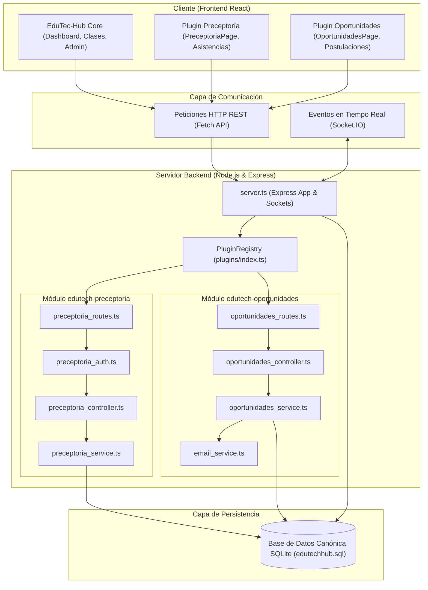
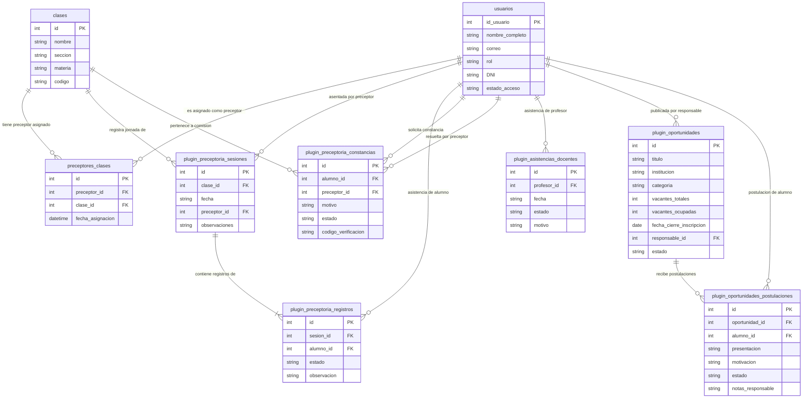
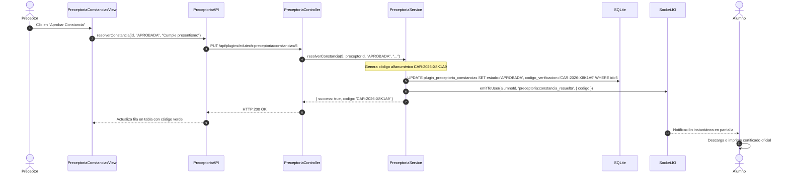
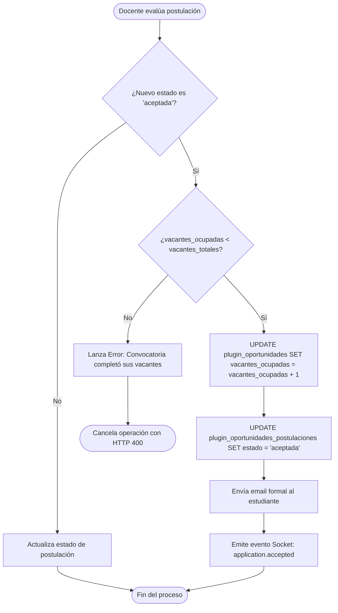

# Diagramas Técnicos de los Plugins (TECH-ROOM 29)

Este documento recopila los diagramas visuales en formato **Mermaid** que describen la arquitectura, la base de datos y la comunicación de los plugins **EduTech Preceptoría** y **EduTech Oportunidades**.

---

## 1. Diagrama General de Arquitectura de la Plataforma

Muestra cómo los plugins se acoplan al núcleo de **EduTec-Hub** de forma no invasiva:

> **Interpretación:**
> Los plugins no modifican los archivos principales del servidor. El archivo `server.ts` solo invoca a `PluginRegistry`, que monta dinámicamente las rutas bajo `/api/plugins/edutech-preceptoria` y `/api/plugins/edutech-oportunidades`. Ambos plugins comparten el bus de WebSockets y la base de datos central.

---

## 2. Diagrama Entidad-Relación (Base de Datos)

Muestra las tablas introducidas por los plugins y cómo se relacionan con las tablas del sistema central (`usuarios` y `clases`):

> **Interpretación:**
> Las entidades centrales (`usuarios` y `clases`) se mantienen intactas. Los plugins agregan tablas especializadas con claves foráneas en cascada (`ON DELETE CASCADE`), garantizando que si un estudiante o clase se desactiva, los registros vinculados mantengan la integridad referencial.

---

## 3. Diagrama de Secuencia: Aprobación de Constancia de Alumno Regular

Muestra el flujo cuando un preceptor aprueba una solicitud de constancia de alumno regular:

---

## 4. Diagrama de Flujo: Evaluación de Vacantes en Postulaciones

Describe cómo el servicio `OportunidadesService` protege el cupo disponible de una pasantía o beca:

> **Interpretación:**
> El sistema previene la sobreinscripción: si una empresa ofrece 3 vacantes, el backend valida matemáticamente la disponibilidad antes de confirmar la admisión del estudiante.
