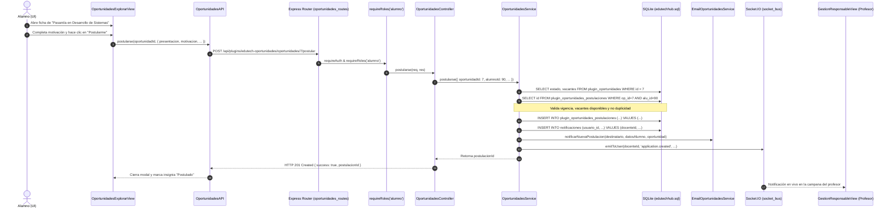

# Integración y Flujo de Comunicación (TECH-ROOM 29)

Este documento detalla cómo interactúan el **Frontend** y el **Backend** en los plugins de EduTec-Hub, ilustrando el recorrido paso a paso de dos operaciones reales de principio a fin.

---

## 1. Recorrido Real 1: Toma y Notificación de Asistencia Escolar

Este flujo representa el caso de uso central del plugin **EduTech Preceptoría**: un preceptor asienta la asistencia de una comisión y el estudiante visualiza la actualización en tiempo real en su panel personal.

```mermaid
sequenceDiagram
    autonumber
    actor Preceptor as Preceptor (UI)
    participant FrontP as PreceptoriaTomaAsistenciaView
    participant APIClient as PreceptoriaAPI
    participant Router as Express Router (preceptoria_routes)
    participant Auth as preceptoria_auth Middleware
    participant Controller as PreceptoriaController
    participant Service as PreceptoriaService
    participant DB as SQLite (edutechhub.sql)
    participant Socket as Socket.IO (socket_bus)
    participant FrontA as AsistenciasAlumnoView (Estudiante)

    Preceptor->>FrontP: Selecciona curso y marca estados (Presente/Ausente/Tarde)
    Preceptor->>FrontP: Clic en "Guardar Asistencia"
    FrontP->>APIClient: guardarAsistencia(claseId, fecha, observaciones, registros)
    APIClient->>Router: POST /api/plugins/edutech-preceptoria/clases/4/asistencia
    Note over Router,Auth: Se verifica cookie connect.sid
    Router->>Auth: requireAuth & requireExclusivoPreceptor
    Auth->>Auth: Verifica rol === 'preceptor' y asignación a clase 4
    Auth->>Controller: Delegación a guardarAsistencia(req, res)
    Controller->>Service: guardarAsistencia(4, "2026-11-16", preceptorId, obs, registros)
    
    rect rgb(30, 20, 50)
        Note over Service,DB: Transacción Atómica SQL
        Service->>DB: BEGIN TRANSACTION
        Service->>DB: INSERT OR REPLACE INTO plugin_preceptoria_sesiones (...)
        Service->>DB: INSERT OR REPLACE INTO plugin_preceptoria_registros (...)
        Service->>DB: COMMIT
    end

    Service->>Socket: emitToClass(4, 'attendance:updated', ...)
    Service->>Socket: emitToUser(alumnoId, 'attendance:recorded', { estado })
    Service-->>Controller: Retorna { success: true, sesionId: 14 }
    Controller-->>APIClient: HTTP 200 JSON { success: true, message: "..." }
    APIClient-->>FrontP: Promesa resuelta con éxito
    FrontP-->>Preceptor: Notificación Toast verde ("Asistencia registrada correctamente")
    
    Socket-->>FrontA: Evento 'attendance:recorded' recibido por WebSocket
    FrontA->>FrontA: Re-calcula porcentaje y actualiza historial en vivo
```

---

### Análisis Etapa por Etapa de la Operación

1. **Acción del Usuario**: El preceptor abre la pestaña *"Toma Diaria"*, selecciona la comisión "6to 1ra" y marca al estudiante "Estudiante Sexto Año" como `AUSENTE`.
2. **Recepción en Componente**: [PreceptoriaTomaAsistenciaView.tsx](file:///c:/Users/marti/EduTec-Hub/plugins/edutech-preceptoria/frontend/components/PreceptoriaTomaAsistenciaView.tsx) actualiza su estado local en React y el usuario presiona el botón de guardar.
3. **Invocación al Cliente de Red**: `PreceptoriaAPI.guardarAsistencia(4, ...)` arma la petición HTTP POST enviando las cabeceras `Content-Type: application/json` y `credentials: 'include'`.
4. **Enrutamiento y Filtros de Seguridad**:
   - [preceptoria_routes.ts](file:///c:/Users/marti/EduTec-Hub/plugins/edutech-preceptoria/backend/routes/preceptoria_routes.ts) recibe la petición en `/clases/:claseId/asistencia`.
   - Interviene [preceptoria_auth.ts](file:///c:/Users/marti/EduTec-Hub/plugins/edutech-preceptoria/backend/middleware/preceptoria_auth.ts):
     - `requireAuth`: Comprueba que `req.session.usuario` exista.
     - `requireExclusivoPreceptor`: Valida que el rol sea `'preceptor'` (impide que alumnos o profesores envíen peticiones falsificadas con curl o Postman).
     - `requirePreceptorAsignadoAClase`: Verifica en la tabla `preceptores_clases` que el preceptor tenga asignada la comisión con ID 4.
5. **Controlador**: `PreceptoriaController.guardarAsistencia` valida que `registros` sea un arreglo no vacío y llama al servicio.
6. **Lógica de Servicio y Persistencia**:
   - [preceptoria_service.ts](file:///c:/Users/marti/EduTec-Hub/plugins/edutech-preceptoria/backend/services/preceptoria_service.ts) abre una transacción SQL.
   - Inserta la jornada en `plugin_preceptoria_sesiones`.
   - Asienta cada registro en `plugin_preceptoria_registros`.
   - Confirma la transacción con `COMMIT`.
7. **Emisión de Eventos en Tiempo Real**:
   - `emitToClass` avisa a la sala de la comisión que la planilla cambió.
   - `emitToUser` envía un socket directo al ID del estudiante con su nuevo estado.
8. **Respuesta y Actualización de Interfaz**:
   - El controlador responde con HTTP 200 JSON.
   - La pantalla del preceptor muestra un mensaje flotante de éxito.
   - El navegador del estudiante recibe el socket y su componente [AsistenciasAlumnoView.tsx](file:///c:/Users/marti/EduTec-Hub/plugins/edutech-preceptoria/frontend/components/AsistenciasAlumnoView.tsx) actualiza el gráfico de asistencia sin necesidad de recargar la página.

---

## 2. Recorrido Real 2: Postulación de Alumno a una Pasantía Técnica

Este flujo representa el caso de uso central del plugin **EduTech Oportunidades**:

---

## 3. Matriz de Seguridad y Políticas de Autenticación

Todas las solicitudes viajan protegidas por sesiones HTTP seguras (`express-session`):

| Escenario | Comportamiento del Sistema | Código HTTP |
| :--- | :--- | :---: |
| **Usuario anónimo (sin cookie de sesión)** | Interceptado por `requireAuth` antes del controlador | `401 Unauthorized` |
| **Alumno intentando tomar asistencia** | Interceptado por `requireExclusivoPreceptor` | `403 Forbidden` |
| **Preceptor queriendo tomar lista en curso ajeno** | Interceptado por `requirePreceptorAsignadoAClase` | `403 Forbidden` |
| **Profesor intentando postularse como alumno** | Interceptado por `requireRoles('alumno')` | `403 Forbidden` |
| **Alumno intentando evaluar postulantes** | Interceptado por `requireRoles('profesor', 'admin')` | `403 Forbidden` |
| **Ruta inexistente bajo el prefijo `/api/*`** | Capturado por el catch-all JSON de Express | `404 Not Found` (JSON) |
