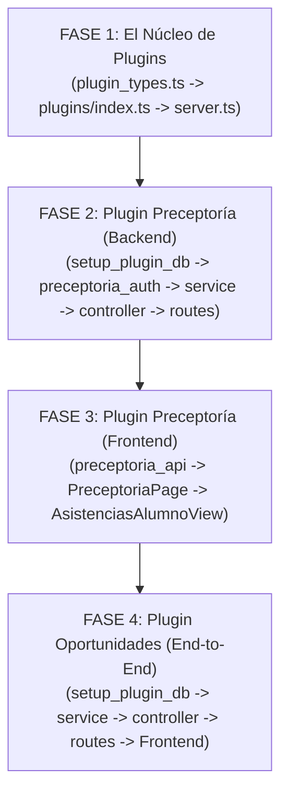

# Guía de Recorrido de Código y Referencia de Archivos (TECH-ROOM 29)

Esta guía fue concebida para que un profesor, evaluador o nuevo desarrollador pueda estudiar el código fuente de los plugins de manera ordenada, didáctica y progresiva, comprendiendo desde los cimientos arquitecturales hasta la interfaz de usuario.

---

## 1. Orden de Lectura Recomendado

Para asimilar la arquitectura sin perderse en detalles secundarios, se recomienda seguir estrictamente este itinerario pedagógico de 4 fases:

---

### Fase 1: El Núcleo y Registro de Plugins
1. **[plugins/plugin_types.ts](file:///c:/Users/marti/EduTec-Hub/plugins/plugin_types.ts)**:
   - *Objetivo de estudio*: Comprender los contratos `PluginManifest` y `BackendPlugin`.
   - *Pregunta clave*: ¿Qué requisitos mínimos debe cumplir un módulo para ser considerado un plugin válido en EduTec-Hub?
2. **[plugins/index.ts](file:///c:/Users/marti/EduTec-Hub/plugins/index.ts)**:
   - *Objetivo de estudio*: Analizar la clase `PluginRegistry`, el método `register` y cómo el método `mountAll` itera sobre los plugins, ejecuta sus migraciones y los monta en Express.
3. **[backend/server.ts](file:///c:/Users/marti/EduTec-Hub/backend/server.ts)** (líneas 75-100 y 200-215):
   - *Objetivo de estudio*: Ver cómo el servidor central invoca a `pluginRegistry.mountAll(app)` antes de las rutas catch-all de la API.

---

### Fase 2: Backend de EduTech Preceptoría
1. **[plugins/edutech-preceptoria/backend/database/setup_plugin_db.ts](file:///c:/Users/marti/EduTec-Hub/plugins/edutech-preceptoria/backend/database/setup_plugin_db.ts)**:
   - *Objetivo*: Estudiar las 5 tablas DDL, las restricciones `UNIQUE` y los índices.
2. **[plugins/edutech-preceptoria/backend/middleware/preceptoria_auth.ts](file:///c:/Users/marti/EduTec-Hub/plugins/edutech-preceptoria/backend/middleware/preceptoria_auth.ts)**:
   - *Objetivo*: Comprender cómo se garantiza la exclusividad del rol Preceptor (`requireExclusivoPreceptor`) y la verificación de comisiones asignadas (`requirePreceptorAsignadoAClase`).
3. **[plugins/edutech-preceptoria/backend/services/preceptoria_service.ts](file:///c:/Users/marti/EduTec-Hub/plugins/edutech-preceptoria/backend/services/preceptoria_service.ts)**:
   - *Objetivo*: Analizar las funciones `obtenerPlanillaFecha`, `guardarAsistencia` (transaccional), `obtenerAsistenciaAlumno` (fórmula de regularidad) y `resolverConstancia`.
4. **[plugins/edutech-preceptoria/backend/controllers/preceptoria_controller.ts](file:///c:/Users/marti/EduTec-Hub/plugins/edutech-preceptoria/backend/controllers/preceptoria_controller.ts)**:
   - *Objetivo*: Ver cómo se capturan los datos de `req`, se llama al servicio y se emiten las respuestas JSON.
5. **[plugins/edutech-preceptoria/backend/routes/preceptoria_routes.ts](file:///c:/Users/marti/EduTec-Hub/plugins/edutech-preceptoria/backend/routes/preceptoria_routes.ts)**:
   - *Objetivo*: Ver la asociación entre métodos HTTP, rutas y middlewares de protección.

---

### Fase 3: Frontend de EduTech Preceptoría
1. **[plugins/edutech-preceptoria/frontend/services/preceptoria_api.ts](file:///c:/Users/marti/EduTec-Hub/plugins/edutech-preceptoria/frontend/services/preceptoria_api.ts)**:
   - *Objetivo*: Conocer los tipos TypeScript del cliente y las llamadas Fetch con `{ credentials: 'include' }`.
2. **[plugins/edutech-preceptoria/frontend/pages/PreceptoriaPage.tsx](file:///c:/Users/marti/EduTec-Hub/plugins/edutech-preceptoria/frontend/pages/PreceptoriaPage.tsx)**:
   - *Objetivo*: Comprender cómo conmuta dinámicamente entre la vista de alumno, docente o preceptor según el rol.
3. **[plugins/edutech-preceptoria/frontend/components/AsistenciasAlumnoView.tsx](file:///c:/Users/marti/EduTec-Hub/plugins/edutech-preceptoria/frontend/components/AsistenciasAlumnoView.tsx)**:
   - *Objetivo*: Analizar la presentación de métricas para el estudiante, el cálculo del porcentaje visual y el tratamiento del estado vacío.
4. **[plugins/edutech-preceptoria/frontend/components/PreceptoriaTomaAsistenciaView.tsx](file:///c:/Users/marti/EduTec-Hub/plugins/edutech-preceptoria/frontend/components/PreceptoriaTomaAsistenciaView.tsx)**:
   - *Objetivo*: Observar la interfaz interactiva con botones rápidos de presentismo (*P*, *A*, *T*, *J*).

---

### Fase 4: Plugin EduTech Oportunidades (End-to-End)
1. **[plugins/edutech-oportunidades/backend/database/setup_plugin_db.ts](file:///c:/Users/marti/EduTec-Hub/plugins/edutech-oportunidades/backend/database/setup_plugin_db.ts)**:
   - *Objetivo*: Tablas `plugin_oportunidades` y `plugin_oportunidades_postulaciones`.
2. **[plugins/edutech-oportunidades/backend/services/oportunidades_service.ts](file:///c:/Users/marti/EduTec-Hub/plugins/edutech-oportunidades/backend/services/oportunidades_service.ts)**:
   - *Objetivo*: Analizar el método `actualizarVigencias()`, la lógica de inscripción en `postularse()` y el control estricto de cupos en `actualizarEstadoPostulacion()`.
3. **[plugins/edutech-oportunidades/backend/controllers/oportunidades_controller.ts](file:///c:/Users/marti/EduTec-Hub/plugins/edutech-oportunidades/backend/controllers/oportunidades_controller.ts)**:
   - *Objetivo*: Validaciones defensivas y emisión de respuestas.
4. **[plugins/edutech-oportunidades/frontend/pages/OportunidadesPage.tsx](file:///c:/Users/marti/EduTec-Hub/plugins/edutech-oportunidades/frontend/pages/OportunidadesPage.tsx)** y sus componentes (`OportunidadesExplorarView`, `MisPostulacionesView`, `GestionResponsableView`).

---

## 2. Tabla Maestra de Referencia de Archivos

| Archivo Fuente | Módulo | Responsabilidad Arquitectural | Función Principal |
| :--- | :--- | :--- | :--- |
| `plugins/plugin_types.ts` | Core | Contratos e Interfaces | Define `PluginManifest` y `BackendPlugin`. |
| `plugins/index.ts` | Core | Registro Central | Monta dinámicamente los plugins en la app Express. |
| `plugins/edutech-preceptoria/manifest.json` | Preceptoría | Configuración | Metadatos, versión y flag `enabled`. |
| `plugins/edutech-preceptoria/backend/index.ts` | Preceptoría | Entrada Backend | Empaqueta manifiesto, router y DB. |
| `.../backend/database/setup_plugin_db.ts` | Preceptoría | Persistencia DDL | Crea tablas e índices de presentismo. |
| `.../backend/middleware/preceptoria_auth.ts` | Preceptoría | Seguridad | Guardas de exclusividad de preceptor y roles. |
| `.../backend/services/preceptoria_service.ts` | Preceptoría | Lógica de Negocio | Toma transaccional de lista y regularidad. |
| `.../backend/controllers/preceptoria_controller.ts` | Preceptoría | Controlador REST | Desempaqueta peticiones HTTP y devuelve JSON. |
| `.../backend/routes/preceptoria_routes.ts` | Preceptoría | Enrutamiento | Mapea endpoints `/clases`, `/constancias`, etc. |
| `.../frontend/services/preceptoria_api.ts` | Preceptoría | Cliente de Red | Métodos Fetch tipados hacia el backend. |
| `.../frontend/pages/PreceptoriaPage.tsx` | Preceptoría | Vista Principal | Alterna vistas según rol del usuario logueado. |
| `.../frontend/components/AsistenciasAlumnoView.tsx` | Preceptoría | Componente UI | Métricas de presentismo y constancias del alumno. |
| `.../frontend/components/PreceptoriaTomaAsistenciaView.tsx` | Preceptoría | Componente UI | Planilla interactiva de toma rápida de asistencia. |
| `.../frontend/components/PreceptoriaConstanciasView.tsx` | Preceptoría | Componente UI | Bandeja de resolución y emisión de constancias. |
| `plugins/edutech-oportunidades/manifest.json` | Oportunidades | Configuración | Metadatos y flag `enabled`. |
| `plugins/edutech-oportunidades/backend/index.ts` | Oportunidades | Entrada Backend | Empaqueta manifiesto, router y DB. |
| `.../backend/database/setup_plugin_db.ts` | Oportunidades | Persistencia DDL | Crea tablas de convocatorias y postulaciones. |
| `.../backend/services/oportunidades_service.ts` | Oportunidades | Lógica de Negocio | Filtros, caducidad automática y control de cupos. |
| `.../backend/services/email_service.ts` | Oportunidades | Notificaciones | Envío de emails formalizando postulaciones. |
| `.../backend/controllers/oportunidades_controller.ts` | Oportunidades | Controlador REST | Desempaqueta peticiones y valida datos de entrada. |
| `.../backend/routes/oportunidades_routes.ts` | Oportunidades | Enrutamiento | Mapea endpoints `/oportunidades`, `/postular`. |
| `.../frontend/services/oportunidades_api.ts` | Oportunidades | Cliente de Red | Métodos Fetch hacia el backend de oportunidades. |
| `.../frontend/pages/OportunidadesPage.tsx` | Oportunidades | Vista Principal | Navegación entre Explorar, Postulaciones y Gestión. |
| `.../frontend/components/OportunidadesExplorarView.tsx` | Oportunidades | Componente UI | Catálogo de pasantías con filtros y modal. |
| `.../frontend/components/MisPostulacionesView.tsx` | Oportunidades | Componente UI | Seguimiento de solicitudes del estudiante. |
| `.../frontend/components/GestionResponsableView.tsx` | Oportunidades | Componente UI | Publicación de búsquedas y evaluación de aspirantes. |

---

## 3. Observaciones Técnicas para Evaluadores

Durante el análisis del código se identificaron los siguientes aspectos arquitecturales notables:

1. **Manejo de Transacciones en Toma de Asistencia**:
   El método `guardarAsistencia` en `preceptoria_service.ts` agrupa la inserción de la sesión y la actualización de todos los alumnos dentro de un bloque `BEGIN ... COMMIT`. Esto garantiza que un corte de energía o error de red no deje una planilla con la mitad de los alumnos asentados.
2. **Prevención de Vacantes Negativas**:
   En `oportunidades_service.ts`, el decremento de cupos utiliza `MAX(0, vacantes_ocupadas - 1)`, evitando que errores de concurrencia produzcan números negativos en las vacantes.
3. **Resiliencia en Ausencia de Datos**:
   El frontend de ambos plugins maneja de forma elegante los estados en los que no existen datos aún (por ejemplo, alumnos recién inscriptos sin asistencias tomadas), mostrando mensajes pedagógicos claros en lugar de errores técnicos.
