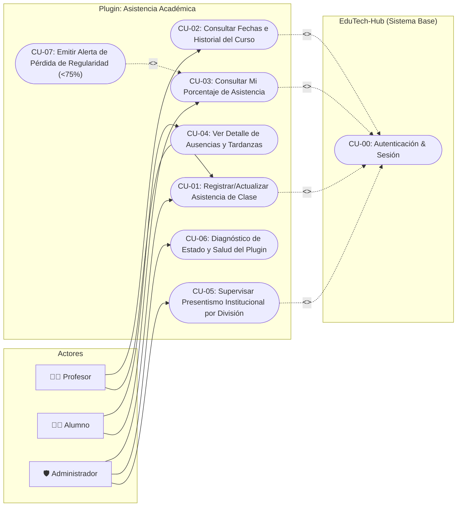
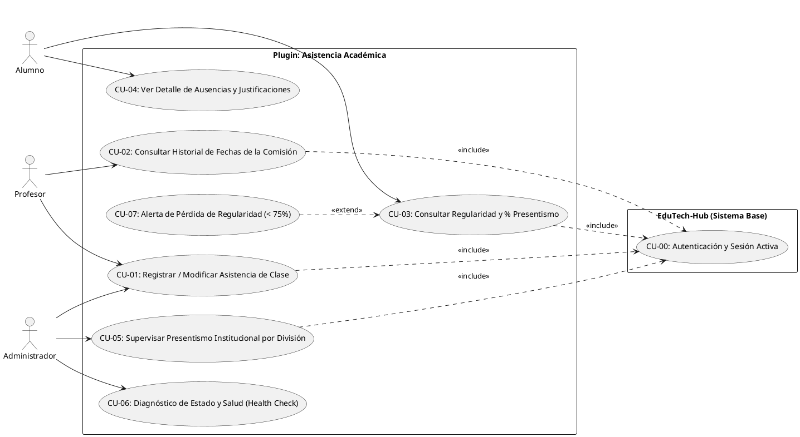
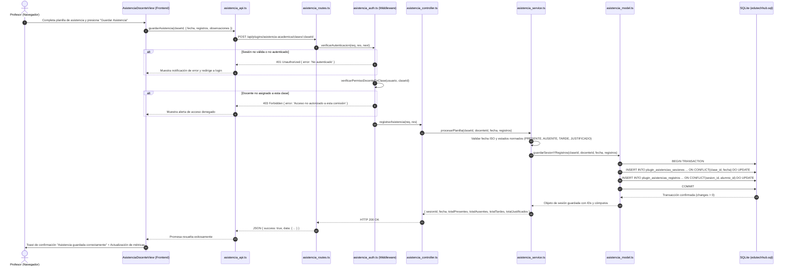
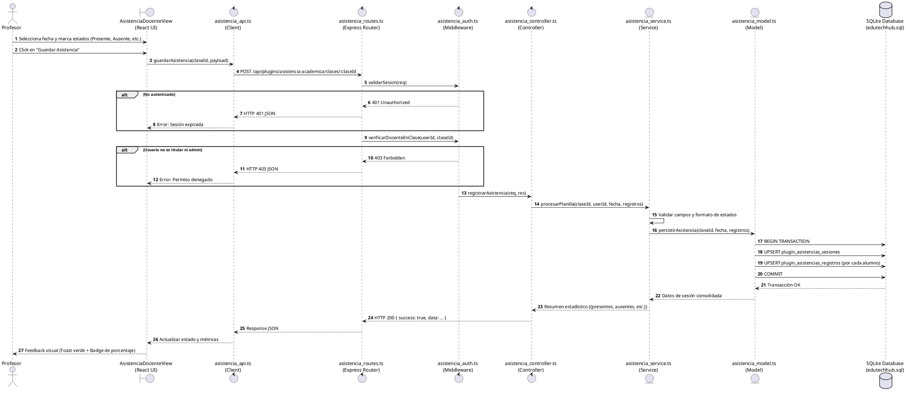

# MODELADO UML DEL PLUGIN: ASISTENCIA ACADÉMICA
## EduTech-Hub — Prácticas Profesionalizantes
**Plugin:** `asistencia-academica`  
**Autor:** Integrante 1 (Equipo de Ingeniería de Software)

---

## 1. Diagrama de Casos de Uso (UML Use Case)

### Diagrama en Formato Mermaid

### Código Fuente PlantUML

---

## 2. Diagrama de Secuencia (UML Sequence)

Representa la operación crítica y principal del plugin: **Registro Idempotente de Asistencia de Clase por parte del Profesor**.

### Diagrama en Formato Mermaid

### Código Fuente PlantUML

